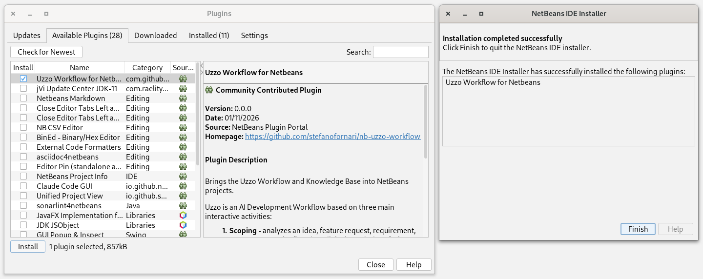
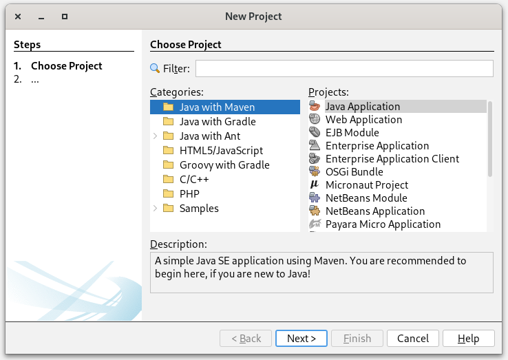
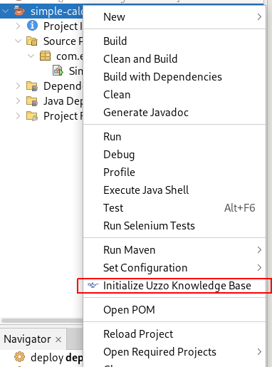
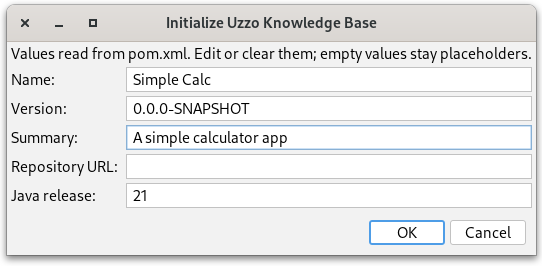
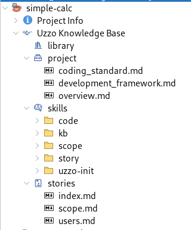
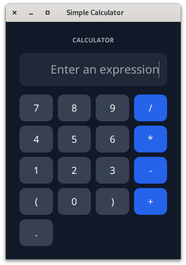

# Create a simple calculator app

This article follows a small calculator project from an initial idea to a
working application, using Uzzo Workflow along the way. It shows how a product
owner can move between scoping, writing stories, and implementation as new
questions arise—not by following a rigid sequence, but by refining the shared
understanding of the product one decision at a time.

The examples below include prompts and generated artifacts from the workflow.
They illustrate how the knowledge base records decisions, makes progress
visible, and gives both the product owner and the AI a consistent context to
work from.

## First, create a project

### Using the command line and an AI CLI

#### Create the project folder and add the skills
1. Download [uzzo-workflow-kb.jar](https://github.com/stefanofornari/uzzo-workflow/releases/download/uzzo-workflow-0.0.1-0.0.2/uzzo-workflow-kb-0.0.1.jar).
1. Create a project directory named `simple-calc`.
1. Unzip the `uzz/` directory from the JAR into `simple-calc/`. For example:
   ```bash
   unzip ~/Downloads/uzzo-workflow-kb-0.0.1.jar uzz/* -d /my/projects/simple-calc
   ```
1. Add the skills in `uzz/skills` to your preferred LLM CLI (see [Installing Skills](../installing-skills.md)).

#### Initialize the knowledge base
1. Start your CLI and invoke the `uzzo-init` skill, usually with `/uzzo-init` or
   a prompt such as `initialize the uzzo knowledge base`.

### Using the NetBeans plugin

#### Create the project
1. Go to **Tools > Plugins > Installed**.
1. Select **Uzzo Workflow for NetBeans**.
    
1. Install up the plugin.
1. Create a standard Maven project:
   1. Select **File > New Project > Java with Maven > Java Application**.
   1. Provide the requested information:
       

#### Initialize the knowledge base
1. Right-click `simple-calc` and select **Initialize Uzzo Knowledge Base**.
    
1. Provide the requested information or accept the proposed values.
    


## Let's scope the project

Either of the two methods above results in a new Uzzo Knowledge Base node under
the project root:



To begin, I described the application I wanted to build in a prompt like this:
```
I want to build a simple calculator application that should run on windows, macos
and linux. It should have the following features:
- support basic arithmetics operations
- allow to use parentesis to group expressions
- show the current expression
- ENTER calculates the expression and show the result
- in case of errors (e.g. divide by 0 or unbalanced parentesis) show a simple error
- clean and modern look&fill
Let's scope the project.
```

I ran this prompt through Copilot using the gpt-6-luna model. Following the
scoping skill, it began by asking clarifying questions:

> ```
> The existing scope is still the initialization template, and there are no existing
> stories to overlap with. Three decisions will make the calculator scope testable.
> Recommended defaults are preselected; the wrong choice could affect UI architecture
> or user expectations.
>
>  How should the app run?
>
> How should the app run?:
> The target operating systems are Windows, macOS, and Linux. A desktop app may
> require platform packaging; a browser app may not feel like an setuped calculator.
> ❯ Cross-platform desktop application (recommended)
>   Web app in a browser
>   Other / specify
>   Other (type your answer)
> ```

I chose *Cross-platform desktop application*.

> ```
> How should users enter expressions?:
> This affects whether the UI needs an on-screen keypad as well as keyboard input.
> ❯ Keyboard and on-screen keypad (recommended)
>   Keyboard only
>   On-screen keypad only
>   Other / specify
>   Other (type your answer)
>```

I chose *Keyboard and on-screen keypad*.

> ```
> What calculation behavior should be in scope?:
> Recommended: +, -, ×, ÷; decimal numbers; conventional precedence and parentheses;
> unary minus; Enter evaluates and shows a result while keeping the expression visible;
> invalid expressions and division by zero show a simple error.
> ❯ Use recommended rules (recommended)
>  Specify different rules
>  Other (type your answer)
> ```

I chose *Use recommended rules*.

After these initial questions, the LLM generated the following scope:

```markdown
# Project Name: simple-calc
**Version:** 0.0.0-SNAPSHOT

## Overall Description

Build a simple calculator desktop application that runs on Windows, macOS, and
Linux. Users can enter expressions with the keyboard or an on-screen keypad,
see the current expression, and press Enter to calculate it. The interface
should have a clean, modern look.

The calculator supports addition, subtraction, multiplication, and division;
decimal numbers; unary minus; conventional operator precedence; and
parentheses for grouping. After a successful calculation, show the result and
keep the expression visible. For division by zero, unbalanced parentheses, or
other invalid expressions, show a simple error.

## In-Scope Capabilities
* **Calculator**:
  - [ ] Run as a desktop application on Windows, macOS, and Linux.
  - [ ] Provide keyboard entry and an on-screen keypad for expressions.
  - [ ] Show the current expression.
  - [ ] Evaluate expressions on Enter, showing the result while keeping the expression visible.
  - [ ] Support addition, subtraction, multiplication, division, decimal numbers, unary minus, conventional precedence, and parentheses.
  - [ ] Show a simple error for division by zero, unbalanced parentheses, and other invalid expressions.
  - [ ] Present a clean, modern interface.

## Out-of-Scope / Future Enhancements
* Scientific, graphing, memory, or variable features; they are not part of the requested basic calculator.
* Calculation history and persistence; neither was requested.
* Installers, auto-updates, or a particular distribution mechanism; the application must run on the listed operating systems, but delivery packaging was not specified.

## Technical Context & Infrastructure
* **Development Toolchain**: Java 21 + Maven
* **Target Systems/Platforms**: Windows, macOS, and Linux desktop
* **UI Framework**: Not selected in the available project documentation.
* **Project Reference Docs**:
  - Coding Standard: `uzz/project/coding_standard.md`
  - Development Framework: `uzz/project/development_framework.md`

### Keywords
- calculator
- desktop
- arithmetic
- expressions
- cross-platform
- scope

```

At this point, I decided that the calculator should also keep an in-memory
history, so I asked the CLI to update the scope:

> I think we should have an history functionality

That request prompted another round of questions:

1. History entries and selection:
   ❯ Expression + result; selecting restores expression
1. How long should history last?:
   ❯ Current app session only
1. Custom history management:
   ❯ Other - Last 20 entries, no clear action

The scope was then updated as follows:

```markdown
# Project Name: simple-calc
**Version:** 0.0.0-SNAPSHOT

## Overall Description

Build a simple calculator desktop application that runs on Windows, macOS, and
Linux. Users can enter expressions with the keyboard or an on-screen keypad,
see the current expression, and press Enter to calculate it. The interface
should have a clean, modern look.

The calculator supports addition, subtraction, multiplication, and division;
decimal numbers; unary minus; conventional operator precedence; and
parentheses for grouping. After a successful calculation, show the result and
keep the expression visible. For division by zero, unbalanced parentheses, or
other invalid expressions, show a simple error.

The application also keeps a session-only history of successful calculations.
Each entry shows the expression and result. Selecting an entry restores its
expression for editing or recalculation. Keep only the 20 most recent entries;
there is no clear-history action.

## In-Scope Capabilities
* **Calculator**:
  - [ ] Run as a desktop application on Windows, macOS, and Linux.
  - [ ] Provide keyboard entry and an on-screen keypad for expressions.
  - [ ] Show the current expression.
  - [ ] Evaluate expressions on Enter, showing the result while keeping the expression visible.
  - [ ] Support addition, subtraction, multiplication, division, decimal numbers, unary minus, conventional precedence, and parentheses.
  - [ ] Show a simple error for division by zero, unbalanced parentheses, and other invalid expressions.
  - [ ] Present a clean, modern interface.
* **Calculation History**:
  - [ ] Record each successful calculation's expression and result for the current app session.
  - [ ] Display the 20 most recent successful calculations.
  - [ ] Restore an entry's expression to the calculator when the entry is selected.
  - [ ] Discard older entries when the history exceeds 20; provide no clear-history action.

## Out-of-Scope / Future Enhancements
* Scientific, graphing, memory, or variable features; they are not part of the requested basic calculator.
* Persisting calculation history across application restarts.
* Installers, auto-updates, or a particular distribution mechanism; the application must run on the listed operating systems, but delivery packaging was not specified.

## Technical Context & Infrastructure
* **Development Toolchain**: Java 21 + Maven
* **Target Systems/Platforms**: Windows, macOS, and Linux desktop
* **UI Framework**: Not selected in the available project documentation.
* **Project Reference Docs**:
  - Coding Standard: `uzz/project/coding_standard.md`
  - Development Framework: `uzz/project/development_framework.md`

### Keywords
- calculator
- desktop
- arithmetic
- expressions
- cross-platform
- scope

```

With the initial scope in place, I was ready to create the user stories:

> Looks good, let's create the user stories

The model correctly noticed that I had not identified an actor for the user
stories. It suggested "Calculator user," but I chose the simpler role "User":


> Copilot needs information.
> The story standard requires each story’s actor to be listed in `uzz/stories/users.md`, but that file still contains only placeholders. Who should the stories be written for? Recommended: **Calculator user** — someone entering expressions to calculate. I’ll add your chosen actor to `users.md` before generating the stories.
>
> Story actor
> Choose the role to use in each AS A clause. You can accept the recommendation or provide another role.
> ❯ User

After updating `stories/users.md`, Copilot created `stories/index.md`, the
index of all the user stories:

```markdown
# Stories Index

> One `##` section per domain. Inside each section, a table with
> `id | title | status`, where status is one of `TODO`, `WIP`, `DONE`, `BLOCKED`, `CLOSED`.
> New stories default to `TODO`; preserve existing statuses.

## calculator

| id | title | status |
|----|-------|--------|
| calculator/US-000001 | Enter and View Calculator Expressions | TODO |
| calculator/US-000002 | Evaluate Arithmetic Expressions | TODO |
| calculator/US-000003 | Receive Errors for Invalid Calculations | TODO |

## calculation-history

| id | title | status |
|----|-------|--------|
| calculation-history/US-000004 | Review Recent Calculations | TODO |
| calculation-history/US-000005 | Reuse an Earlier Expression | TODO |

### Keywords
- stories
- index
- backlog

```

Two domains seemed excessive for this small application. Reviewing the stories
also made me realize that I needed a story covering installation and launch on
each supported platform. I went back to scoping to refine the project scope and
consolidate the domains:

> I have reviewed the index and realized we miss how to setup/handle the application
> on the supported platforms. Let's cope what we want to cover here.
> In addition, I would merge calculator and calculation-history domains in one.

After a few clarifying questions, the scope and story index were updated. The
resulting index was:

```markdown
# Stories Index

> One `##` section per domain. Inside each section, a table with
> `id | title | status`, where status is one of `TODO`, `WIP`, `DONE`, `BLOCKED`, `CLOSED`.
> New stories default to `TODO`; preserve existing statuses.

## calculator

| id | title | status |
|----|-------|--------|
| calculator/US-000001 | Enter and View Calculator Expressions | TODO |
| calculator/US-000002 | Evaluate Arithmetic Expressions | TODO |
| calculator/US-000003 | Receive Errors for Invalid Calculations | TODO |
| calculator/US-000004 | Review Recent Calculations | TODO |
| calculator/US-000005 | Reuse an Earlier Expression | TODO |

## setup

| id | title | status |
|----|-------|--------|
| setup/US-000006 | Install and Launch on Windows | TODO |
| setup/US-000007 | Install and Launch on macOS | TODO |
| setup/US-000008 | Install and Launch on Linux | TODO |

### Keywords
- stories
- index
- backlog
```

Next, I asked the CLI to create the user stories. It generated one file for
each story in the index. Here is an example:

```markdown
## calculator/US-000001 — Enter and View Calculator Expressions

### User Story


AS A User
I WANT to enter an expression with my keyboard or the on-screen keypad
SO THAT I can see what I am about to calculate


#### Status
TODO

#### Dependencies
- None

#### Notes
1. Keep the expression area and input controls visually distinct in a clean, modern interface.

### Acceptance Criteria

Scenario: Enter an expression using the keyboard
  Given the calculator is open
  When the user types "12 + (3"
  Then the current expression is shown as "12 + (3"

Scenario: Enter an expression using the on-screen keypad
  Given the calculator is open
  When the user selects keypad buttons for "12 + (3"
  Then the current expression is shown as "12 + (3"

### References
- [Project Scope](../../scope.md)

### Keywords
- calculator
- expression
- keyboard
- keypad
```

Because we had not yet chosen a UI toolkit, I asked the model to use JavaFX 23
and update the scope and related artifacts accordingly:

> We will use JavaFX for the UI; please make sure to capture it in scope other
> artifacts if needed.

This prompted a question about whether JavaFX should be bundled with the
application or downloaded separately, and the scope and setup stories were
updated accordingly. This kind of refinement along the way is natural in Uzzo
Workflow: scoping, writing stories, and coding do not have to happen in a fixed
sequence. As product owners learn more, they can refine an idea, change
direction, and validate assumptions until the desired result becomes clear.

With the requirements refined, I was ready to implement the first user story:

> let's implement US-1

The story is first marked WIP in `index.md`; implementation then begins. The
result looks like this:



I let the CLI continue implementing and checking each story. When I reviewed
US-4, however, I realized that the implemented history UI was not what I had in
mind. I wanted a hidden history that would let me use the Up and Down arrow keys
to move through previous expressions and edit them. As in agile development, I
did not need to revisit every earlier phase or rewrite detailed specifications;
I only needed to restate the user story:

> mmmh... I wanted the history feature done differently:
> - old expressions do not need to be shown
> - when the user press UP/DOWN key the expression display shows the previous
>   or next expression in the history

After a short while, the application was up and running, and the story index
reflected the current development status. I will leave the setup stories to the
reader. The resulting index was:

```markdown
# Stories Index

> One `##` section per domain. Inside each section, a table with
> `id | title | status`, where status is one of `TODO`, `WIP`, `DONE`, `BLOCKED`, `CLOSED`.
> New stories default to `TODO`; preserve existing statuses.

## calculator

| id | title | status |
|----|-------|--------|
| calculator/US-000001 | Enter and View Calculator Expressions | DONE |
| calculator/US-000002 | Evaluate Arithmetic Expressions | DONE |
| calculator/US-000003 | Receive Errors for Invalid Calculations | DONE |
| calculator/US-000004 | Browse Recent Expressions with Arrow Keys | DONE |
| calculator/US-000005 | Merged into calculator/US-000004 | CLOSED |

## setup

| id | title | status |
|----|-------|--------|
| setup/US-000006 | Install and Launch on Windows | TODO |
| setup/US-000007 | Install and Launch on macOS | TODO |
| setup/US-000008 | Install and Launch on Linux | TODO |

### Keywords
- stories
- index
- backlog

```


## Conclusion

This calculator example shows how Uzzo Workflow helps keep development
grounded in product intent while making room for change. The project knowledge
base brings together the artifacts needed to understand and track the work:

- A comprehensive description of the project's scope and features.
- A high-level view of what the application does—and does not—include.
- User stories that make the requirements understandable to non-developers.
- A clear status of completed work and what remains.
- An implementation supported by unit tests.

Most importantly, these artifacts can evolve as the product owner's
understanding changes. Scoping, story writing, and implementation remain
connected activities, so the team can adjust course without losing the context
behind its decisions.
